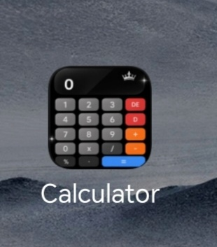
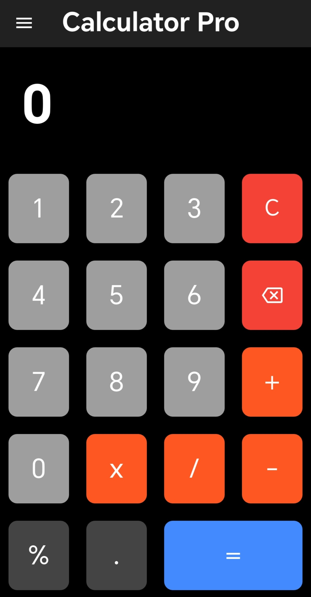
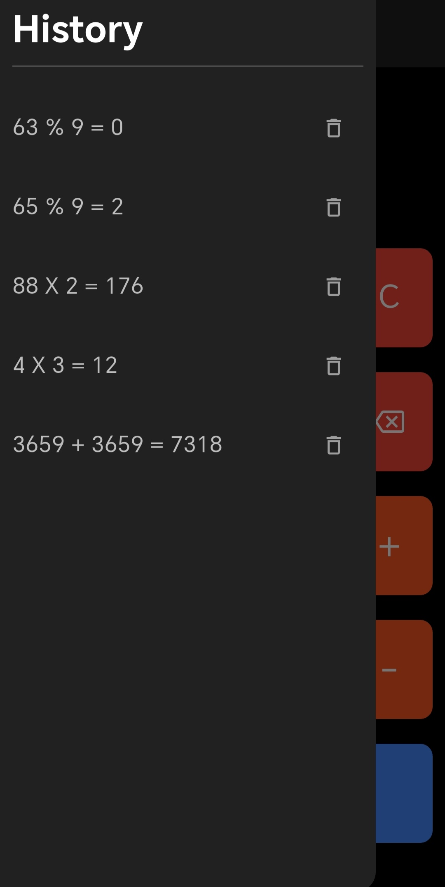
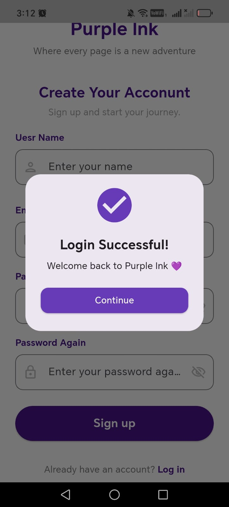
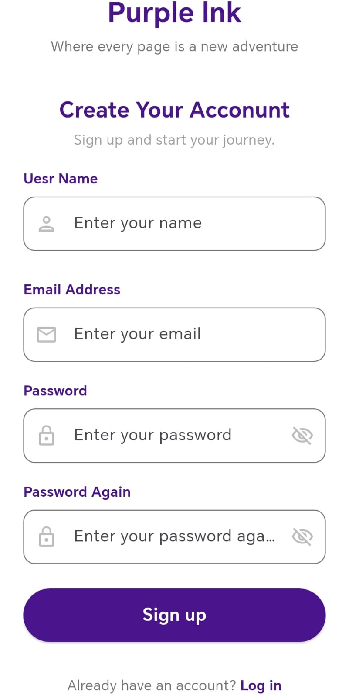
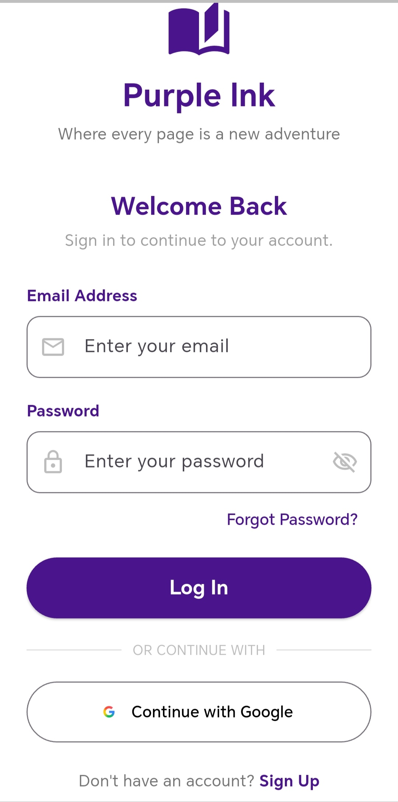
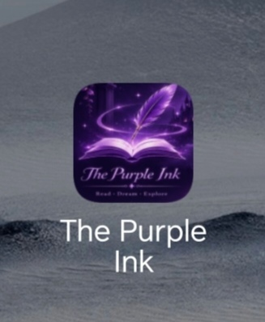

Hi, I'm Almasa 💜

Application Developer | Flutter & Dart

Welcome to my GitHub profile!

I'm a programming graduate passionate about building elegant, practical, and user-friendly applications.

👩🏻‍💻 About Me

- 🎓 Programming Graduate
- 📱 Interested in Mobile App Development
- 💙 Currently working with Flutter and Dart
- 🛠️ Building projects and improving my development skills
- ✨ I believe every great application starts with a simple idea.

🧰 Technologies & Tools

- Flutter
- Dart
- C#
- Windows Forms
- Git & GitHub
- VS Code

🚀 Featured Projects

- Calculator Pro 3.0 — A Flutter calculator application.
- Bank System — A C# banking system project.
- Calculator App — A desktop calculator built with C#.

💜 My Goal

To keep learning, building, and turning ideas into useful applications.

---

## 🧮 Calculator Pro 3.0

A Flutter calculator application.

---

## 💜 Purple Ink

A Flutter-based novel reading application currently under development.

